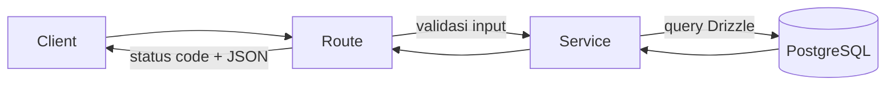
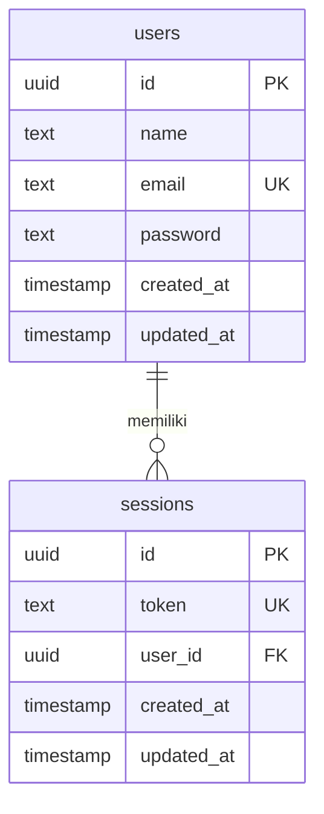

# belajar-vibe-coding

Backend REST API untuk registrasi, login, profil, dan logout user. Autentikasi memakai token sesi (uuid) yang disimpan di database dan dikirim lewat header `Authorization: Bearer <token>`.

Proyek ini juga menjadi tempat belajar vibe coding: fitur dikerjakan bertahap dari issue GitHub, masing-masing lewat Pull Request.

## Daftar Isi

- [Teknologi dan Library](#teknologi-dan-library)
- [Struktur Proyek dan Arsitektur](#struktur-proyek-dan-arsitektur)
- [API yang Tersedia](#api-yang-tersedia)
- [Schema Database](#schema-database)
- [Setup Proyek](#setup-proyek)
- [Menjalankan Aplikasi](#menjalankan-aplikasi)
- [Testing](#testing)

## Teknologi dan Library

| Nama                | Jenis                | Fungsi                                                          | Dipakai di                                   |
|---------------------|----------------------|-----------------------------------------------------------------|----------------------------------------------|
| Bun                 | Runtime, package manager | Menjalankan TypeScript, install dependency, menjalankan tes | Seluruh proyek                               |
| TypeScript          | Bahasa               | Pengetikan statis (`bun check` untuk typecheck)                 | Seluruh proyek                               |
| ElysiaJS (`elysia`) | Library              | Web framework: routing dan validasi request                     | `src/routes/`, `src/index.ts`                |
| Drizzle ORM (`drizzle-orm`) | Library      | Query database dan definisi schema                              | `src/db/`, `src/services/`                   |
| `postgres`          | Library              | Driver PostgreSQL untuk Drizzle                                 | `src/db/index.ts`                            |
| Drizzle Kit (`drizzle-kit`) | Dev dependency | Membuat dan menjalankan migration                             | `drizzle.config.ts`, folder `drizzle/`       |
| `typescript`, `@types/bun` | Dev dependency | Compiler dan tipe untuk Bun                                  | Typecheck dan editor                         |
| `Bun.password`      | Bawaan Bun           | Hash dan verifikasi password dengan bcrypt                      | `src/services/users-services.ts`, `src/services/auth-services.ts` |
| `bun test`          | Bawaan Bun           | Test runner                                                     | `src/tests/`                                 |
| PostgreSQL          | Database             | Penyimpanan data `users` dan `sessions`                         | Seluruh aplikasi                             |
| GitHub Actions      | CI                   | Menjalankan typecheck, migration, dan tes di setiap PR          | `.github/workflows/ci.yml`                   |

## Struktur Proyek dan Arsitektur

```
.
├── .github/
│   └── workflows/
│       └── ci.yml               # CI: typecheck, migration, tes
├── drizzle/                     # File migration SQL + metadata (di-commit ke git)
│   ├── 0000_round_firebird.sql
│   ├── 0001_public_molten_man.sql
│   └── meta/
├── src/
│   ├── index.ts                 # Entry point: menyusun route dan menjalankan server
│   ├── db/
│   │   ├── env.ts               # Membaca kredensial database dari environment
│   │   ├── index.ts             # Koneksi database (Drizzle + postgres)
│   │   └── schema.ts            # Definisi tabel (users, sessions)
│   ├── routes/                  # Routing Elysia (urusan HTTP)
│   │   ├── health.ts
│   │   ├── users-routes.ts
│   │   └── auth-routes.ts
│   ├── services/                # Business logic (tidak tahu detail HTTP)
│   │   ├── users-services.ts
│   │   └── auth-services.ts
│   ├── utils/
│   │   └── bearer-token.ts      # Helper membaca token dari header Authorization
│   └── tests/                   # Semua tes + helper tes
│       ├── helpers.ts
│       ├── health.test.ts
│       ├── users-routes.test.ts
│       ├── auth-routes.test.ts
│       └── bearer-token.test.ts
├── .env.example                 # Contoh environment variable
├── drizzle.config.ts            # Konfigurasi Drizzle Kit
├── package.json
└── tsconfig.json
```

### Aturan penamaan file

| Jenis     | Format                                | Contoh                                                  |
|-----------|---------------------------------------|---------------------------------------------------------|
| Route     | `<nama>-routes.ts` di `src/routes/`   | `users-routes.ts`, `auth-routes.ts` (pengecualian: `health.ts`) |
| Service   | `<nama>-services.ts` di `src/services/` | `users-services.ts`, `auth-services.ts`               |
| Tes       | `<nama file source>.test.ts` di `src/tests/` | `users-routes.test.ts` untuk `users-routes.ts`   |
| Migration | Dibuat otomatis oleh Drizzle Kit      | `0001_public_molten_man.sql` (jangan diedit manual)     |

Satu file tes untuk satu file source: semua API dalam satu file route dites di satu file tes yang sama.

### Pembagian tanggung jawab

- **Route** (`src/routes/`): membaca input dan header, memvalidasi body dengan Elysia (`t`), memanggil service, lalu menerjemahkan hasil atau error dari service menjadi status code dan response.
- **Service** (`src/services/`): berisi business logic dan akses database lewat Drizzle. Service tidak tahu apa-apa soal HTTP (status code, header).
- **DB** (`src/db/`): koneksi dan schema database.
- **Utils** (`src/utils/`): helper kecil yang dipakai bersama oleh beberapa route.

### Alur request



## API yang Tersedia

| Method   | Path                        | Butuh login | Fungsi                              | File route                   |
|----------|-----------------------------|-------------|-------------------------------------|------------------------------|
| `GET`    | `/health`                   | Tidak       | Cek status server dan database      | `src/routes/health.ts`       |
| `POST`   | `/api/v1/users`             | Tidak       | Registrasi user baru                | `src/routes/users-routes.ts` |
| `POST`   | `/api/v1/login`             | Tidak       | Login, mendapatkan token            | `src/routes/auth-routes.ts`  |
| `GET`    | `/api/v1/users/profile`     | Ya          | Data user yang sedang login         | `src/routes/users-routes.ts` |
| `DELETE` | `/api/v1/logout`            | Ya          | Logout, menghapus sesi              | `src/routes/auth-routes.ts`  |

### Alur autentikasi

1. Daftar lewat `POST /api/v1/users`.
2. Login lewat `POST /api/v1/login`. Server membuat sesi baru dan mengembalikan token (uuid).
3. Kirim token di header `Authorization: Bearer <token>` ke endpoint yang butuh login (`GET /api/v1/users/profile`, `DELETE /api/v1/logout`).
4. Logout lewat `DELETE /api/v1/logout` menghapus sesi milik token itu saja. Sesi lain milik user yang sama (misalnya login dari perangkat lain) tetap berlaku.

### Status code

| Status | Arti                                                                                  |
|--------|---------------------------------------------------------------------------------------|
| `200`  | Berhasil                                                                              |
| `401`  | Tidak terautentikasi: token tidak ada, format header salah, token tidak valid, atau (untuk login) email atau password salah |
| `409`  | Email sudah terdaftar (registrasi)                                                    |
| `422`  | Body request tidak valid (field kurang, format email salah, tipe data salah)          |
| `503`  | Database tidak bisa diakses (`/health`)                                               |

### Perilaku yang perlu diketahui

- Sesi tidak punya masa berlaku. Token berlaku sampai user logout.
- Dua request registrasi dengan email yang sama yang dikirim bersamaan bisa membuat request yang kalah mengembalikan `500`, bukan `409`. Jika dikirim berurutan, hasilnya `409`.

### `GET /health`

Mengecek status server dan koneksi database.

```bash
curl http://localhost:3000/health
```

### `POST /api/v1/users`

Registrasi user baru. Password disimpan sebagai hash bcrypt. Email yang sudah terdaftar ditolak.

**Request body:**

```json
{
  "name": "John Doe",
  "email": "john.doe@example.com",
  "password": "password"
}
```

```bash
curl -X POST http://localhost:3000/api/v1/users \
  -H "Content-Type: application/json" \
  -d '{"name":"John Doe","email":"john.doe@example.com","password":"password"}'
```

### `POST /api/v1/login`

Login user. Jika berhasil, server membuat sesi baru dan mengembalikan token (uuid) yang dipakai di endpoint yang butuh login.

**Request body:**

```json
{
  "email": "john.doe@example.com",
  "password": "password"
}
```

```bash
curl -X POST http://localhost:3000/api/v1/login \
  -H "Content-Type: application/json" \
  -d '{"email":"john.doe@example.com","password":"password"}'
```

### `GET /api/v1/users/profile`

Mengambil data user yang sedang login (`id`, `name`, `email`, `createdAt`). Password tidak pernah dikembalikan.

**Headers:**

```
Authorization: Bearer <token>
```

```bash
curl http://localhost:3000/api/v1/users/profile \
  -H "Authorization: Bearer <token>"
```

### `DELETE /api/v1/logout`

Logout user yang sedang login. Sesi dengan token yang dikirim dihapus, sehingga token itu tidak bisa dipakai lagi. Sesi lain milik user yang sama tidak terpengaruh.

**Headers:**

```
Authorization: Bearer <token>
```

```bash
curl -X DELETE http://localhost:3000/api/v1/logout \
  -H "Authorization: Bearer <token>"
```

## Schema Database

Schema didefinisikan di [`src/db/schema.ts`](src/db/schema.ts) dan diterapkan lewat migration di folder `drizzle/`.



### Tabel `users`

| Kolom        | Tipe      | Aturan                                     |
|--------------|-----------|--------------------------------------------|
| `id`         | uuid      | Primary key, dibuat otomatis (random uuid) |
| `name`       | text      | Not null                                   |
| `email`      | text      | Not null, unique                           |
| `password`   | text      | Not null, berisi hash bcrypt               |
| `created_at` | timestamp | Not null, default `now()`                  |
| `updated_at` | timestamp | Not null, default `now()`                  |

### Tabel `sessions`

| Kolom        | Tipe      | Aturan                                                        |
|--------------|-----------|---------------------------------------------------------------|
| `id`         | uuid      | Primary key, dibuat otomatis (random uuid)                    |
| `token`      | text      | Not null, unique, berisi uuid yang dikembalikan saat login    |
| `user_id`    | uuid      | Not null, foreign key ke `users.id`, `ON DELETE CASCADE`      |
| `created_at` | timestamp | Not null, default `now()`                                     |
| `updated_at` | timestamp | Not null, default `now()`                                     |

Satu user bisa memiliki banyak sesi (satu sesi per login). Jika user dihapus, semua sesinya ikut terhapus.

Kolom `created_at` dan `updated_at` bertipe `timestamp` tanpa zona waktu, jadi nilai `createdAt` di response profil bisa bergeser sesuai zona waktu database.

### Migration

Folder `drizzle/` berisi riwayat perubahan database dan **harus di-commit ke git**. Jangan mengedit atau menghapus file di dalamnya secara manual.

Alur mengubah schema:

1. Ubah `src/db/schema.ts`.
2. Generate migration: `bun run db:generate`.
3. Terapkan ke database: `bun run db:migrate`.

## Setup Proyek

### Prasyarat

- [Bun](https://bun.sh/) (versi terbaru)
- PostgreSQL yang sudah berjalan, dengan database kosong yang sudah dibuat, misalnya:

  ```sql
  CREATE DATABASE belajar_vibe_coding;
  ```

### Langkah

1. Clone repository ini, lalu masuk ke foldernya.
2. Install dependency:

   ```bash
   bun install
   ```

3. Salin file contoh environment, lalu sesuaikan dengan database Anda:

   ```bash
   cp .env.example .env
   ```

4. Jalankan migration untuk membuat tabel:

   ```bash
   bun run db:migrate
   ```

### Environment variable

| Variable      | Keterangan                    | Contoh                |
|---------------|-------------------------------|-----------------------|
| `DB_HOST`     | Host PostgreSQL               | `localhost`           |
| `DB_USER`     | Username database             | `postgres`            |
| `DB_PASSWORD` | Password database             | (password Anda)       |
| `DB_NAME`     | Nama database                 | `belajar_vibe_coding` |
| `PORT`        | Port server (default `3000`)  | `3000`                |

Catatan:

- Port PostgreSQL di-hardcode ke `5432` di [`src/db/env.ts`](src/db/env.ts) dan tidak bisa diubah lewat environment variable.
- File `.env` berisi kredensial dan sudah masuk `.gitignore`. Jangan di-commit.

## Menjalankan Aplikasi

Development (hot reload):

```bash
bun run dev
```

Production:

```bash
bun run start
```

Server berjalan di `http://localhost:3000` (atau sesuai `PORT`). Cek dengan:

```bash
curl http://localhost:3000/health
```

### Daftar script

| Script                | Perintah                | Fungsi                                       |
|-----------------------|-------------------------|----------------------------------------------|
| `bun run dev`         | `bun --watch src/index.ts` | Jalankan server dengan hot reload         |
| `bun run start`       | `bun src/index.ts`      | Jalankan server untuk production             |
| `bun run db:generate` | `drizzle-kit generate`  | Buat file migration dari perubahan schema    |
| `bun run db:migrate`  | `drizzle-kit migrate`   | Terapkan migration ke database               |
| `bun run typecheck`   | `bun check`             | Cek error tipe TypeScript                    |
| `bun run test`        | `bun test`              | Jalankan semua tes                           |

## Testing

Semua tes ada di `src/tests/`, satu file tes untuk satu file source:

| File tes                         | Yang dites                                          |
|----------------------------------|-----------------------------------------------------|
| `src/tests/health.test.ts`       | `GET /health`                                       |
| `src/tests/users-routes.test.ts` | `POST /api/v1/users`, `GET /api/v1/users/profile`   |
| `src/tests/auth-routes.test.ts`  | `POST /api/v1/login`, `DELETE /api/v1/logout`       |
| `src/tests/bearer-token.test.ts` | helper `extractBearerToken`                         |

Tes API memakai database PostgreSQL sungguhan dari `.env` (tanpa mock), jadi sebelum menjalankan tes pastikan PostgreSQL berjalan dan migration sudah dijalankan.

Jalankan semua tes:

```bash
bun run test
```

Jalankan satu file tes:

```bash
bun test src/tests/auth-routes.test.ts
```

Cek tipe TypeScript:

```bash
bun run typecheck
```

Setiap tes membuat user dengan email unik miliknya sendiri, lalu menghapus kembali hanya data tersebut setelah tes selesai. Data lain di database tidak tersentuh.

Satu tes ditandai `test.failing`: registrasi bersamaan dengan email yang sama (lihat [Perilaku yang perlu diketahui](#perilaku-yang-perlu-diketahui)). Tes ini mendokumentasikan bug yang sudah diketahui. Jika bug itu diperbaiki, tes akan gagal sebagai pengingat untuk mengubahnya kembali menjadi `test()` biasa.

### CI

Workflow [`.github/workflows/ci.yml`](.github/workflows/ci.yml) berjalan di setiap Pull Request dan setiap push ke `main`. Langkahnya: install dependency, `bun run typecheck`, `bun run db:migrate`, lalu `bun run test`, dengan PostgreSQL 16 sebagai service.
